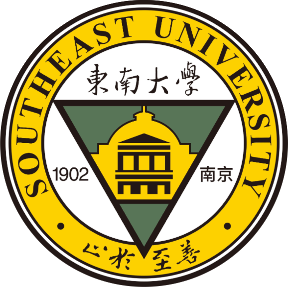
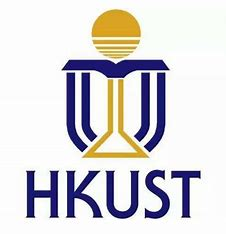
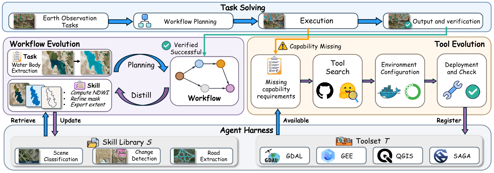

<h1 align="center">RemoteEvolver</h1>
<h3 align="center">Expanding Earth Observation Capabilities through Agent Harness Evolution</h3>

<p align="center">
<a href="https://xushengxianggg.github.io/">Shengxiang&nbsp;Xu</a><sup>*</sup>&nbsp;&nbsp; &nbsp; <a href="https://1e12leon.top/">Liang&nbsp;Yao</a><sup>*</sup>&nbsp; &nbsp; <a href="https://multimodality.group/author/%E9%99%88%E5%A7%9D%E6%BC%AA/">Shuyi&nbsp;Chen</a>&nbsp; &nbsp; <a href="https://orcid.org/0009-0001-7886-2933">Yishu&nbsp;Wang</a>&nbsp;<br>
<a href="https://cs.seu.edu.cn/shimindi/main.htm">Shimin&nbsp;Di</a><sup><a href="mailto:shimin.di@seu.edu.cn">&#9993;</a></sup>&nbsp; &nbsp; <a href="https://multimodality.group/author/%E5%88%98%E5%87%A1/">Fan&nbsp;Liu</a><sup><a href="mailto:fanliu@hhu.edu.cn">&#9993;</a></sup>&nbsp; &nbsp; <a href="https://multimodality.group/author/%E5%A7%9A%E5%BF%85%E9%A1%BA/">Bishun&nbsp;Yao</a>&nbsp; &nbsp; <a href="https://ghh1125.github.io/">Hanghui&nbsp;Guo</a>&nbsp;<br>
<a href="https://scholar.google.com/citations?user=00jeCbkAAAAJ">Xinyu&nbsp;Liu</a>&nbsp; &nbsp; Chengye&nbsp;Liang&nbsp; &nbsp; <a href="https://luoyuyu.vip/">Yuyu&nbsp;Luo</a>&nbsp; &nbsp; <a href="https://palm.seu.edu.cn/zhangml/">Min-Ling&nbsp;Zhang</a>&nbsp;
</p>

<p align="center">
  <sup>*</sup> Equal contribution &nbsp;&nbsp; <sup>&#9993;</sup> Corresponding authors
</p>

<p align="center">
  <a href="https://arxiv.org/abs/2611.27110"></a>
  <a href="LICENSE"></a>
</p>

## News

- **2026/11/27:** We're excited to share the core implementation of RemoteEvolver!
- **2026/11/20:** Our [paper](https://arxiv.org/abs/2611.27110) is now available on arXiv. Check it out!

## Introduction

Welcome to the official repository of **RemoteEvolver: Expanding Earth Observation Capabilities through Agent Harness Evolution**!

Remote sensing agents combine perception models and geospatial tools to answer Earth observation queries. Yet understanding a request and planning its solution are not enough when a specialized capability is missing. Adjusting a workflow or generating a script cannot always replace the perception capabilities of a pretrained model.

This motivates **RemoteEvolver**, a self-evolving harness that connects capability acquisition with reusable experience. **Dynamic toolset expansion** identifies capability gaps during execution and acquires external tools through repository discovery, adaptation, validation, and registration. **Skill library consolidation** turns verified successful trajectories into procedural skills that guide later tasks.

The two mechanisms work together: workflows involving newly acquired tools can become skills, retaining both the capability and the knowledge needed to use it. Our experiments demonstrate improved task-solving performance through the joint evolution of tools and skills.

<p align="center">
  <a href="assets/method.pdf"></a>
</p>

## Installation

Requires **Python 3.10+** and **Git**.

```bash
git clone https://github.com/XuShengXianggg/RemoteEvolver.git
cd RemoteEvolver

python -m venv .venv
source .venv/bin/activate
python -m pip install -e .
```

On Windows PowerShell, activate the environment with `.venv\Scripts\Activate.ps1` instead.

## Quick Start

Run the commands below from the repository root.

### 1. Configure API services

Create `.env` from the template if you do not already have one:

```bash
cp .env.example .env
```

Fill in the model name, API endpoint, and key for the **main model**, **judge**, and **embedding service** in `.env`. The main model must support OpenAI-compatible tool calling. Optionally set `GITHUB_TOKEN` for authenticated GitHub searches. On PowerShell, use `Copy-Item` instead of `cp`.

### 2. Run the example

```bash
# Validate configuration without making API requests
python run.py check-config

# Run the bundled task
python run.py
```

The default configuration uses [examples/tasks.jsonl](examples/tasks.jsonl) with the bundled NDVI and averaging tools. Both tool and skill evolution are enabled.

### 3. Run your own tasks

Prepare a JSONL file following [examples/tasks.jsonl](examples/tasks.jsonl), including a reference answer for evaluation. Copy the default configuration:

```bash
cp configs/default.yaml configs/my-run.yaml
```

Edit these entries in `configs/my-run.yaml` to point to your tasks, output workspace, and initial tools:

```yaml
tasks: ../data/tasks.jsonl
workspace: ../workspace/my-run
initial_tools_dir: ../examples/initial-tools
```

YAML paths are relative to the configuration file. Use absolute paths for input files listed in a task's `inputs` field. To supply your own initial tools, follow [the MCP wrapper examples](examples/initial-tools), set `initial_tools_dir` and `tools.always_exposed`, and install their dependencies.

```bash
python run.py --config configs/my-run.yaml check-config
python run.py --config configs/my-run.yaml run
```

Answers, scores, and token usage are saved to `results/tasks.jsonl` inside the workspace, alongside `logs/`, task `artifacts/`, and `snapshots/`. A snapshot is saved after each completed task. **To resume**, repeat the run command with the same configuration and workspace; use a new workspace for an independent run.

## Evaluation

Copy the configuration used for your evolution run:

```bash
cp configs/my-run.yaml configs/evaluate.yaml
```

Edit the following entries in `configs/evaluate.yaml`. Replace `<snapshot-name>` with a saved snapshot directory and use a separate output workspace:

```yaml
mode: test
tasks: ../data/test.jsonl
workspace: ../workspace/my-test
snapshot: ../workspace/my-run/snapshots/<snapshot-name>
skill_evolution: true
```

```bash
python run.py --config configs/evaluate.yaml check-config
python run.py --config configs/evaluate.yaml run
```

Test mode uses the snapshot's tools and skills without further evolution. Keep `skill_evolution: true` to enable retrieval of existing skills.

## Citation

For more RemoteFamily work, please see https://remotefamily.github.io/.

```bibtex
@misc{xu2026remoteevolver,
  title={{RemoteEvolver: Expanding Earth Observation Capabilities through Agent Harness Evolution}},
  author={Shengxiang Xu and Liang Yao and Shuyi Chen and Yishu Wang and Shimin Di and Fan Liu and Bishun Yao and Hanghui Guo and Xinyu Liu and Chengye Liang and Yuyu Luo and Min-Ling Zhang},
  year={2026},
  eprint={2611.27110},
  archivePrefix={arXiv},
  primaryClass={cs.CV},
  url={https://arxiv.org/abs/2611.27110}
}
```

## License

This project is released under the [MIT License](LICENSE).
